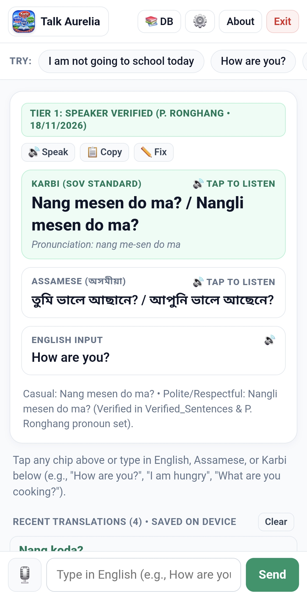
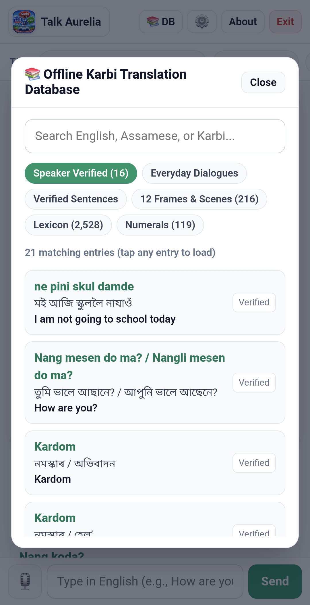
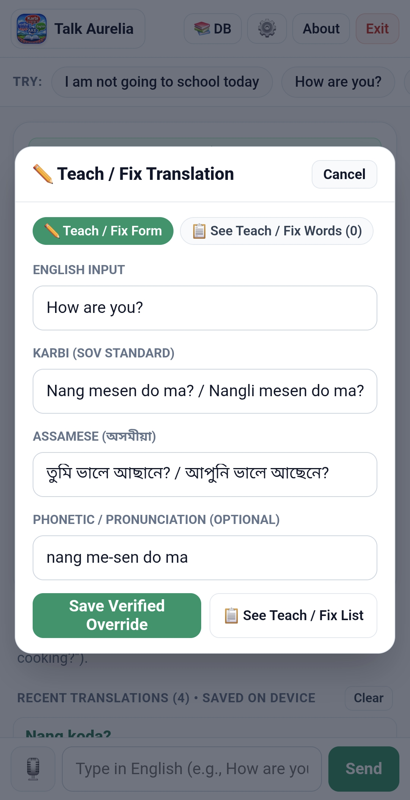
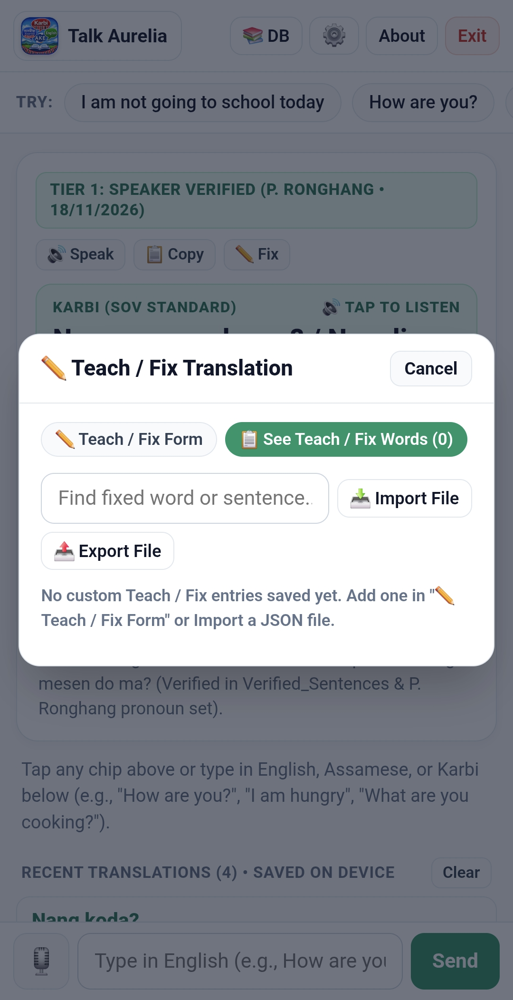
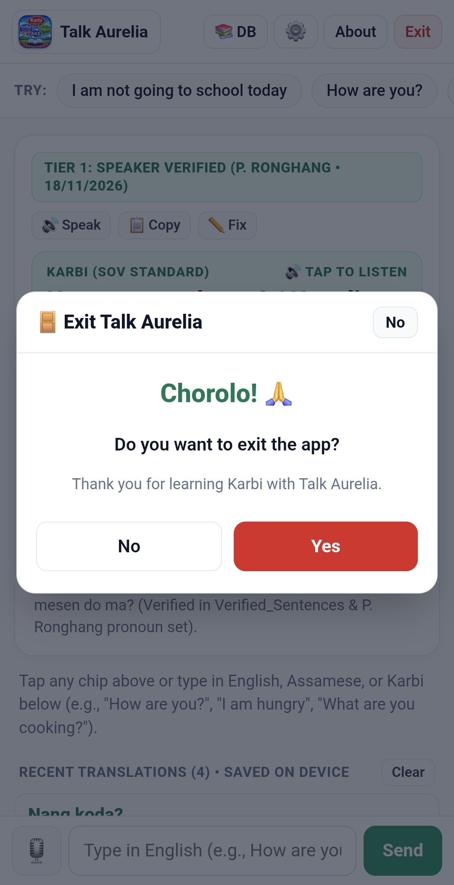

<div align="center">
  
  <h1>Talk Aurelia • Learn Karbi Language</h1>
  <p><strong>Offline Trilingual Karbi, Assamese & English Learning Assistant</strong></p>

  <p>
    <a href="https://github.com/medhi79/Learn-Karbi/releases/latest">
      
    </a>
    
    
  </p>
</div>

---

## Overview

**Talk Aurelia** is an offline-first Android language assistant and translation tool built for **Karbi**, **Assamese (অসমীয়া)**, and **English**[cite: 52, 53]. Designed around authentic Karbi **Subject–Object–Verb (SOV)** grammar[cite: 53] and speaker-verified expressions, it helps learners, students, and educators translate everyday phrases, practice pronunciation, and expand custom vocabulary offline[cite: 53, 56].

---

## App Screenshots

| Main Translation Dashboard | Offline Translation Database |
| :---: | :---: |
|  |  |
| *Trilingual SOV output with phonetic pronunciation & casual/polite forms* | *Search across Speaker Verified entries, 216 Frames & Scenes, 2,528 Lexicon words, and Numerals* |

| Teach / Fix Translation Override | Custom JSON Import & Export | Exit Confirmation |
| :---: | :---: | :---: |
|  |  |  |
| *Add verified overrides on-device* | *Backup & restore custom JSON lists* | *Cultural greetings ("Kardom" / "Chorolo!")* |

---

## Key Features

* **Trilingual SOV Translation Engine:** Translates seamlessly across **Karbi**, **Assamese (অসমীয়া)**, and **English** with phonetic pronunciation guides and casual (`Nang`) vs. polite/respectful (`Nangli`) pronoun forms[cite: 53].
* **Rich Offline Knowledge Base (`DB`):** Includes speaker-verified sentences, everyday dialogues, **12 Frames & Scenes (216 entries)**, a **2,528-word Lexicon**, and **119 Numerals**—all searchable offline[cite: 56].
* **Native Android Voice Input & TTS Audio:** Speak directly using Android's speech recognizer or tap any translation card to listen via offline Text-to-Speech[cite: 53].
* **Teach / Fix Community Overrides:** Correct or add new trilingual entries directly inside the app and export/import custom rules as `.json` files[cite: 54, 55].
* **Persistent Device History:** Automatically saves recent translations locally on your device for quick offline review[cite: 53].

---

## Download & Install (Android)

1. Go to the **[Releases](https://github.com/medhi79/Learn-Karbi/releases/latest)** page.
2. Under **Assets**, download **`release-signed.apk`** (recommended for daily use) or **`debug.apk`**[cite: 48].
3. Open the downloaded `.apk` file on your Android device and allow installation from your browser/file manager if prompted.

---

## Repository Structure

```text
Learn-Karbi/
├── .github/workflows/build-apk.yml          # Automated Gradle CI/CD workflow for debug & signed APKs
├── android/                                 # Native Android Kotlin WebView & TTS/Speech bridge
├── index.html                               # Core offline trilingual web app & translation engine
├── Karbi_A_Letter_Vocabulary_Final_Handcrafted.json
├── Karbi_Full_Vocabulary_Substitution_Drills.json
├── karbi_corrections.json
├── karbi_custom_lessons.json
└── README.md
